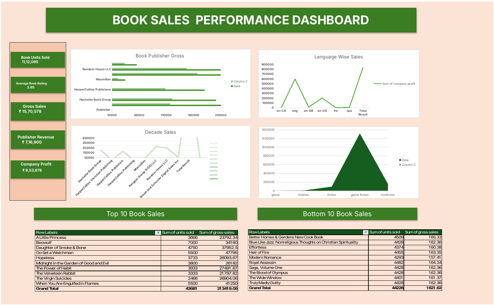
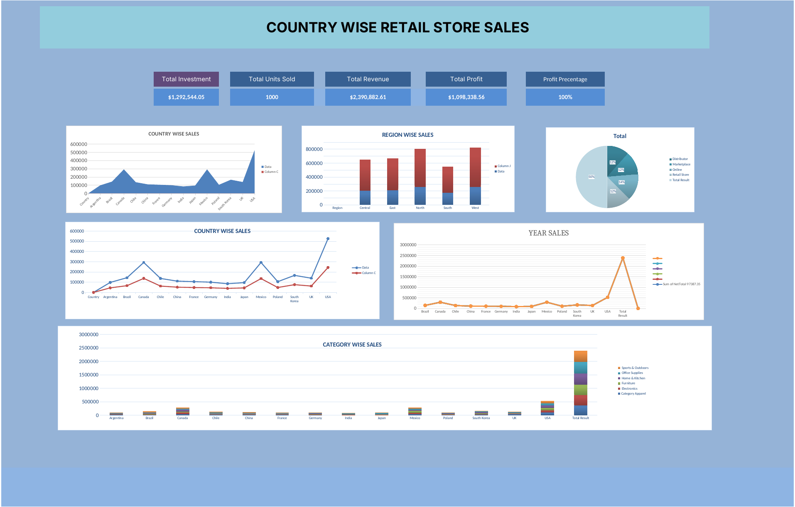

# Excel Dashboards

Two interactive Excel dashboard projects built with PivotTables, PivotCharts and Slicers.

## Projects

### 1. Book Sales & Profit
**File:** [`Book_Sales_and_Profit_Dashboard.xlsx`](Book_Sales_and_Profit_Dashboard.xlsx)

Analyzes about 490 books by publishing year and decade, author rating, book rating, ratings count and language, along with publisher-level units sold, publisher revenue, gross sales and company profit.

### 2. Country-Wise Retail Sales
**File:** [`Country_Wise_Retail_Sales_Dashboard.xlsx`](Country_Wise_Retail_Sales_Dashboard.xlsx)

Analyzes 1,000 retail orders across regions, countries, sales channels, categories and products, covering net sales and profit by country.

## Tools Used
- Microsoft Excel
- PivotTables and PivotCharts
- Slicers for interactive filtering
- Formulas (e.g. `TEXT`, `GETPIVOTDATA`)

## How to Use
1. Download the `.xlsx` file you want to explore.
2. Open it in Microsoft Excel (desktop version recommended, since slicers may not work in Excel Online or other viewers).
3. Go to the dashboard sheet and use the slicers to filter the data.

## Author
Shekhar-630
